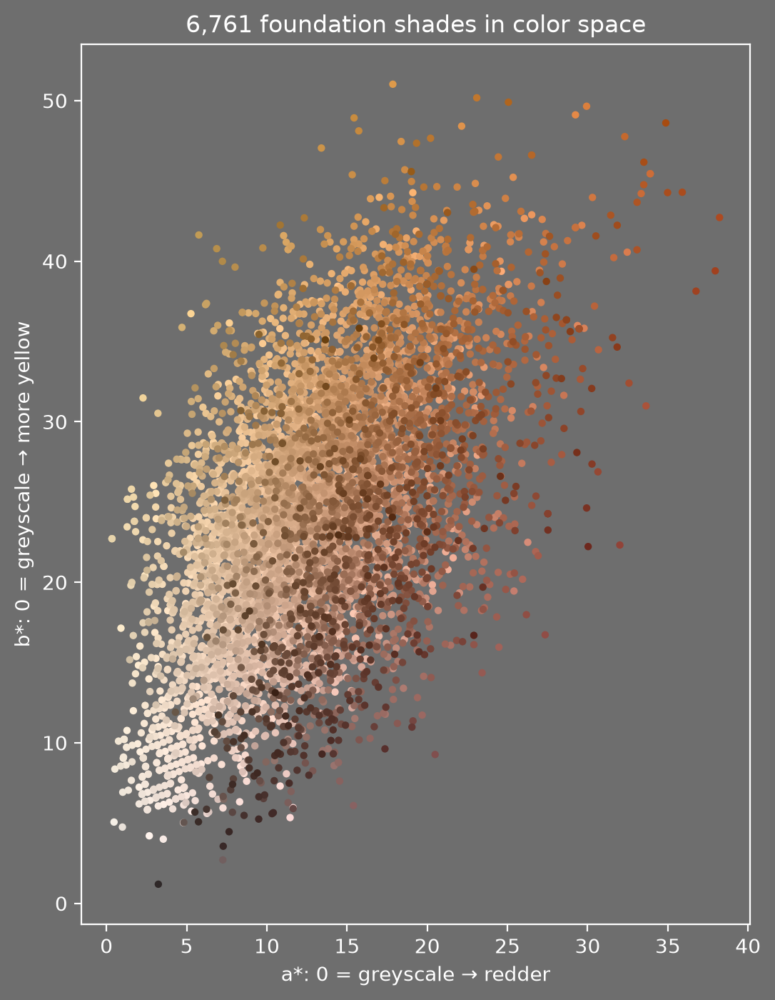

# Foundation Color Spectrum
 
**Shades, words and prices: what the color spectrum says about the foundation market**
 
Data analytics capstone project (Spiced Academy, 2026): a color analysis of 6,761 foundation shades sold at Sephora and Ulta (2021), by depth, undertone and price.

**[View the interactive Tableau story](https://public.tableau.com:9443/views/foundation_color_spectrum/Story1_1?:language=en-US&publish=yes&:sid=&:redirect=auth&:display_count=n&:origin=viz_share_link)**
 

 
## Why this project
 
As a teenager, I couldn't find a drugstore foundation light enough for me. In the end, I had to buy more expensive foundations that matched me better. Today, I still see people across skin tones struggling to find their shade, and my impression is that some groups struggle more than others: especially people with the fairest and the deepest skin, and people with olive or muted undertones. This project looks at what the data actually says.
 
## Business question
 
How well does a beauty retailer's foundation assortment cover the full range of depths and undertones, and can shoppers rely on the shade descriptions to find their match?
 
**Why it matters:** a shopper who can't find or trust their shade online doesn't buy, or buys the wrong one. Every shade that doesn't match costs a retailer a sale, or a customer.
 
## Measuring depth: the Monk Skin Tone Scale
 
To group shades by depth, I needed an external yardstick: an official way to describe skin color that doesn't come from a brand. I used the [Monk Skin Tone Scale](https://skintone.google), 10 skin tones developed by Harvard sociologist Ellis Monk and released with Google in 2022, built so technology can be tested fairly across all skin tones. As far as I know, it's the most recent and most inclusive scale of its kind.
 
I use it for **lightness only**. Ten tones can't describe every skin color: each depth comes with at least three undertones (cool, neutral, warm), plus olive. So each shade gets the Monk tone closest in lightness, and undertone is measured separately.
 
Looking at the Monk tones in black and white showed something interesting: their lightness steps aren't even. Monk 1 to 3 are almost the same lightness, and the biggest jump is between Monk 5 and 6. So I also grouped the shades into 10 equal lightness steps, as a second scale to compare with.
 
## Questions answered
 
1. **Depth:** Where do shades sit across the 10 Monk Skin Tones, and across 10 equal lightness steps?
2. **Depth by foundation:** Do foundations with more shades also reach more depths?
3. **Words vs color:** Do the brands' undertone words (cool, neutral, warm) match the measured color?
4. **Olive:** What does "olive" mean in the data?
5. **Hue by depth:** How does the measured hue change from light to deep shades?
6. **Price:** Do shades at the lightest and deepest ends cost more?
The original plan also had questions on parent companies (conglomerates) and on depth words (e.g. "fair", "deep"). These were left out to keep the scope manageable.
 
## Key findings
 
- **Shades crowd the middle.** 81% of shades sit in Monk 4 to 6, and only 1% in Monk 9 and 10. Part of this comes from the Monk scale's uneven steps, so I checked with 10 equal lightness steps too: the spread is a bit more even, but about 60% of shades still sit in steps 2 to 4. Either way, most brands leave gaps at both ends.
- **More shades don't mean more depths.** 45 foundations have more shades than average but reach fewer depths than average. 40 foundations do the opposite: fewer shades, more depths.
- **The words point the right way, but they don't separate shades.** Brands use 232 different undertone words. The typical (median) hue does rise from cool to warm, by about 6 degrees, but the middle halves of the labels overlap heavily, and some pairs share the exact same hex code with opposite descriptions.
- **In the data, olive means very yellow, not muted.** Only 4.5% of shades are called olive, and almost none at the ends. At every depth, olive shades measure the most yellow, and together with warm shades they carry the most color.
- **The deeper the shade, the redder it measures.** Since the brands' words don't separate shades, I made my own grouping from the measurements: all shades sorted by measured hue and split into three equal groups, the redder, middle and yellower third. If light and deep shades had the same mix of hues, every depth would show about one third of each. They don't: at Monk 1, 80% of shades are in the yellower third; at Monk 8, 86% are in the redder third.
- **The ends aren't more expensive, but there's very little there.** Median price per ml or g: about $1.35 at Monk 1, $1.55 in the middle, $0.86 at Monk 10. Monk 1 has only 30 shades in total, and just 5 of them come from budget brands. Monk 10 rests on 3 products, only 2 of them with a price.
**Recommendations for a retailer**
 
1. Measure every shade on the shelf with one method, so shades compare across brands. Then a shopper who wants to try a new brand or formula, say a more hydrating one for winter, can enter the shade they already wear and see the closest matches.
2. Count depths, not shades, when choosing brands.
3. Combine this with the retailer's own data: searches without a purchase, returns and reviews.
## Data sources
 
| Source | What it's used for | Collected | Credit | License |
|---|---|---|---|---|
| [The Pudding: "The Naked Truth" (2021)](https://github.com/the-pudding/data/tree/master/foundation-names) | Base dataset: 6,816 foundation shades from Sephora and Ulta | Sephora: January 11, 2021; Ulta: January 18, 2021 | Story by Ofunne Amaka, data and code by Amber Thomas | MIT License |
| [Monk Skin Tone Scale](https://skintone.google/get-started) | Depth scale (10 tones) | Developed by Ellis Monk; released with Google in 2022 | Monk, Ellis. "Monk Skin Tone Scale." https://skintone.google | CC BY 4.0 |
| [Makeup Insights: Customer Reviews](https://www.kaggle.com/datasets/zarasarkar/makeup-insights-customer-reviews/data) | Ulta prices | July 9–11, 2024 | Zara Sarkar | MIT License |
| [Sephora Products and Skincare Reviews](https://www.kaggle.com/datasets/nadyinky/sephora-products-and-skincare-reviews) | Sephora prices | March 2023 | Nady Inky | CC BY 4.0 |
 
The original product photos belong to Sephora and Ulta.
 
## Method
 
1. **Python (notebooks 00–03):** download and explore the data, test the merge with the price data, clean it, and convert each shade's hex code to CIELAB and LCh: lightness (L\*), chroma (how vivid or muted) and hue (redder or yellower). Conversion with `rgb2lab` from scikit-image.
2. **Python (notebook 04):** load everything as text into a local PostgreSQL database.
3. **dbt Core:** transform the data in three layers (staging → intermediate → marts). The Monk scale comes in as a seed.
4. **Python (notebook 05):** extract the brands' undertone words from the shade descriptions and unify them onto one scale (cool, cool neutral, neutral, warm neutral, warm, unlabeled), plus a separate olive flag. Loaded into dbt as a lookup table.
5. **Python (notebook 06):** the color map, every shade plotted as a dot in its own color.
6. **Tableau:** the final story, built on the dbt marts.

**Main decisions**
 
- **Depth:** each shade gets the Monk tone with the closest lightness (L\*) only, since the Monk scale describes depth, not undertone. The equal lightness steps split the range from the lightest to the deepest shade in the data into 10 bands of the same width. The full L\* scale (0 = black, 100 = white) isn't a scale of skin, so the market's own range made more sense as the starting point.
- **Hue thirds:** all shades sorted by measured hue angle and cut into three equal groups (redder < 58.14°, middle 58.14–65.72°, yellower > 65.72°). These are relative groups, not undertone labels. Since each third holds the same number of shades overall, every depth would show about one third of each group if light and deep shades had the same mix of hues; differences from that show how hue changes with depth.
- **Price per unit:** price per ml (liquids) or per g (powders, sticks, creams). It shows what you pay for the amount in the package, not how long a product lasts.
- **Re-measured near-white swatches:** for a few very light shades, the most common color in the swatch image was the background (e.g. a white sponge) rather than the foundation itself. For 66 shades, I re-measured the color from the swatch images in Python, using the same method as the original dataset by Amber Thomas, and checked each one by eye. 1 shade was left out, because its color couldn't be read from any image.
- **Removed:** duplicate shade copies, travel sizes (they repeat full-size shades), mixers and pigments (e.g. a blue mixing pigment), and products with fewer than 3 shades.
## Limitations
 
- **Colors as shown online:** the hex codes come from retailer swatch photos, so they measure each shade as it appears on the website, not in the bottle.
- **Shelf, not skin:** the data shows what's on the shelf, not which skin tones exist. Comparing the two would need real skin measurements.
- **Different years:** the shades are from January 2021, the prices from 2023 and 2024, and prices exist only for matched products (about half).
- **US only:** both retailers are US-based.
- **Small numbers at the ends:** the gap at both ends is a finding in itself, but it also means the price and hue results for Monk 1, 9 and 10 rest on very few products, so they're less certain than the results in the middle.
- **Undertone labels are my rules:** turning free-text descriptions into categories involves decisions (e.g. how to read brand codes like C/N/W), which are documented in notebook 05.
## Repository structure
 
```
foundation-color-spectrum/
├── README.md
├── data_dictionary.md     ← all columns, including the new ones
├── requirements-dbt.txt   ← Python packages for dbt
├── data/
│   ├── raw/               ← original downloads, never edited
│   ├── manual/            ← hand-checked color re-measurements (notebook 03)
│   └── processed/         ← files the notebooks create (ignored by git)
├── 01_notebooks/          ← run in order: 00 to 06
├── 02_dbt/                ← staging, intermediate, marts; seeds/monk_scale.csv
└── 03_tableau/            ← Tableau workbook; images/ holds the pictures used in it
```
 
## How to run it
 
1. Run the notebooks in `01_notebooks/` in order, from 00 to 06. Notebook 06 makes the color map image.
2. Install the dbt packages and build the models from inside `02_dbt/`:
```
pip install -r requirements-dbt.txt
cd 02_dbt
dbt seed
dbt run
```
 
You need a local PostgreSQL database and your own `profiles.yml` (not included in the repo).
 
## Status
 
Presented on November 23, 2026. Planned improvements: consistent field names across the dbt marts and more detailed comments in the notebooks.
